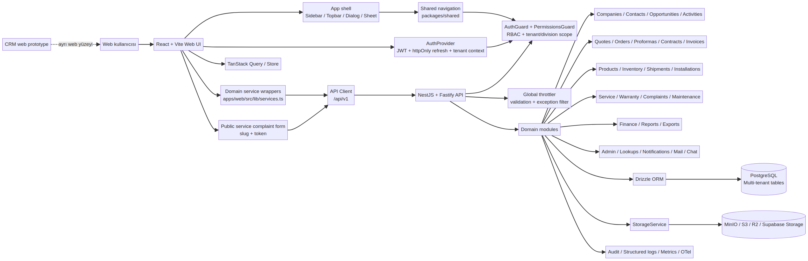

# Haksan Web ERP/CRM — A’dan Z’ye Ekran, Pop-up ve Mimari Envanteri

**Hazırlayan:** Manus AI  
**Kapsam:** Masaüstü/web ana uygulaması (`apps/web`), onu destekleyen API ve ayrı CRM web prototipi (`crm app`)  
**Kapsam dışı:** `apps/mobile-v2` mobil uygulaması  
**İnceleme yaklaşımı:** Kaynak kodu, ortak navigasyon tanımları, dialog bileşenleri, frontend servis katmanı, backend modülleri, README ve veritabanı şeması üzerinden statik envanter.

> Bu doküman, uygulamanın yalnızca ana menü isimlerini değil; her ana ekranın alt sekmelerini, kartlarını, tablolarını, filtrelerini, işlem menülerini, modal/dialog pencerelerini, drawer ve popover yüzeylerini, form alanlarını, rol koşullarını ve ekranların bağlandığı teknik katmanları birlikte gösterir.

## 1. Kapsam ve önemli ayrım

Projede iki ayrı web yüzeyi bulunur. `apps/web`, üretim hedefli ana Haksan ERP/CRM uygulamasıdır. `crm app` ise ayrı bir CRM web prototipidir; kendi ekran kabuğu, mock/statik veri yaklaşımı ve daha genel ekran bileşenleri vardır. Bu iki yüzey aynı ürün ailesinin parçaları gibi görünse de aynı router veya aynı veri akışını kullanmaz. [1]

Mobil uygulama özellikle kapsam dışında bırakılmıştır. Bu nedenle `apps/mobile-v2` altındaki tab, stack, mobile modal, bottom sheet ve mobil detay ekranları bu envanterde yer almaz. Ana web uygulamasındaki responsive mobil web drawer ise masaüstü/web uygulamasının responsive kabuğunun parçası olduğu için ayrıca belirtilmiştir.

| Envanter sınıfı | Dahil edilen kaynak | Durum | Not |
|---|---|---|---|
| Ana web ERP/CRM | `apps/web` | Birincil uygulama | Gerçek API, yetki, tenant ve veri akışına bağlı |
| Web backend | `apps/api` | Ana web destek katmanı | NestJS, Drizzle, PostgreSQL, storage ve RBAC |
| Ortak tip/şema | `packages/shared` | Ana web ile ortak | Zod şemaları, sabitler, navigation ve izin kataloğu |
| CRM web prototipi | `crm app` | Ayrı prototip | Root/detail ekranları, mock yaklaşımı ve kendi navigasyonu |
| Mobil uygulama | `apps/mobile-v2` | Hariç | Kullanıcı talebi doğrultusunda dokümana alınmadı |

## 2. Uygulamanın üst seviye bilgi mimarisi

Ana web uygulamasında `App.tsx` ekran seçimini, `Layout.tsx` ise ortak uygulama kabuğunu yönetir. Klasik URL-router yerine uygulama içinde aktif `NavKey`/ekran seçimi ve detay seçicileriyle çalışan bir shell yaklaşımı görülür. Kimlik doğrulama ve onboarding tamamlanmadan önce login, şifre yenileme ve tanıtım yüzeyleri; oturum açıldıktan sonra ana layout ve yetkili ekranlar gösterilir. [2] [3]

| Katman | Kullanıcıya görünen grup | Ana ekranlar |
|---|---|---|
| Kimlik ve başlangıç | Oturum/kurulum | Giriş, Şifremi Unuttum, Yeni Şifre, Onboarding |
| Genel | Günlük çalışma alanı | Gösterge Paneli, Sohbet, Takvim |
| Satış | CRM çekirdeği | Firmalar, Fırsatlar, Referanslar |
| Satış Operasyonu | Satışın destek kayıtları | Kontaklar, Firma Haritası, Teklifler, Ticari Belge Merkezi, Satış Fiyat Listesi |
| Operasyon | Ürün ve lojistik | Ürünler, Stok, Ödemeler & Kasa, Muhasebe Faturaları, Cari Rapor, Vade Takvimi, Sevkiyat |
| Servis | Saha sonrası operasyon | Makineler, Kurulum, Servis Talepleri, Servis Kanban, Servis Fiyat Listesi |
| Yönetim | Yetki ve şirket ayarları | Raporlar, Kullanıcılar, Roller & Yetkiler, Departmanlar, Ayarlar |
| Public web | Authsuz müşteri bildirimi | Public Service Complaint formu |

## 3. Giriş, kimlik ve başlangıç ekranları

### 3.1 Giriş ekranı

Giriş yüzeyi, kullanıcı adı/e-posta ve parola ile oturum başlatır. Başarılı login sonrasında `/auth/me` üzerinden kullanıcı, tenant, roller, departmanlar, bölümler ve erişim kapsamları alınır. Oturum süresi dolduğunda istemci cache’i temizlenir ve kullanıcı login yüzeyine döner. [4]

### 3.2 Şifre akışları

| Yüzey | Kullanıcıya görünen ad | Alanlar/işlemler |
|---|---|---|
| Şifre unutma | Şifremi Unuttum | E-posta, gönderme, başarı/hata mesajı |
| Yeni şifre | Yeni Şifre Belirle | Reset token, yeni parola, parola tekrarı, kaydet |
| Oturum hatası | Session expired | Oturumu temizle, yeniden giriş |

### 3.3 Onboarding

Onboarding, yeni kullanıcının Haksan çalışma alanını ve bölüm/departman navigasyonunu tanıtan başlangıç akışıdır. Bu ekran ana operasyon kayıtlarını oluşturmaz; kullanıcıyı uygulama kabuğuna hazırlar.

## 4. Ortak web uygulama kabuğu

`Layout.tsx` bütün yetkili ekranların etrafına sidebar, topbar, page header, içerik alanı, bildirim yüzeyi ve komut paletini yerleştirir. Bu nedenle aşağıdaki yüzeyler ayrı bir sayfa olmasalar da uygulamanın her ekranında kullanılabilen bağımsız arayüz alanlarıdır. [3]

### 4.1 Sidebar ve navigasyon

Sidebar’da Haksan logosu, ürün tanımı, sabitlenenler, son kullanılan ekranlar, navigation group başlıkları ve grup altındaki ekran butonları bulunur. Grup başlıkları açılıp kapatılabilir. Sidebar daraltılabilir; daraltılmış görünümde ikon tooltip’leri kullanılır. `⌘K`/`Ctrl+K` ve `/` komut paletini açar.

| Alan | İçerik ve davranış |
|---|---|
| Logo alanı | Haksan Makina logosu; daraltılmış/geniş görünüm |
| Sabitlenenler | Kullanıcının mevcut sayfayı sabitleme/kaldırma tercihi |
| Son kullanılan | En son kullanılan en fazla birkaç ekran |
| Navigation group | Genel, Satış, Satış Operasyonu, Operasyon, Servis, Yönetim |
| Rozetler | Sohbet okunmamışı, açık servis talepleri ve açık kanban servis sayısı |
| Çalışma alanı | Departman ve bölüm seçicileri |
| Responsive drawer | Küçük ekranda “Ana menü” sheet/drawer görünümü |

### 4.2 Üst bar

Üst barda responsive menü butonu, global arama alanı, aktif bölüm/departman seçici, onaylar, hızlı oluşturma, yardım merkezi, bildirimler ve kullanıcı menüsü bulunur.

| Üst bar yüzeyi | Açılınca görünen içerik |
|---|---|
| Global arama | “Bu sayfa içinde veya tüm kayıtlarda ara...” metni ve komut kısayolu |
| Çalışma alanı menüsü | Bölüm: Tümü veya yetkili bölümler; Departman: yetkili departmanlar |
| Onay kalkanı | Onay bekleyen firma erişim talepleri |
| Hızlı Oluştur | Firma, kontak ve fırsat oluşturma izinlerine göre seçenekler |
| Yardım Merkezi | SSS, destek e-postası/telefonu, klavye kısayolu |
| Bildirim Merkezi | CRM bildirimleri ve operasyon uyarıları |
| Hesap menüsü | Sayfayı sabitle, yoğunluk, profil/ayarlar, kısayollar, raporlar, yönetim, çıkış |

### 4.3 Global pop-up, menü ve yardımcı yüzeyler

| Yüzey adı | Tür | İçerik/işlem |
|---|---|---|
| Komut Paleti | Dialog/command palette | Ekran ve operasyon arama; firma/fırsat hedefi; `⌘K`, `Ctrl+K`, `/` ile açılır |
| Bildirim Merkezi | Dropdown menu | Yeni CRM bildirimleri, kritik/uyarı/takip öğeleri, hedef ekrana yönlendirme |
| Hesabım & Analiz | Dropdown menu | Bu sayfayı sabitle/kaldır, rahat/kompakt görünüm, Profil & Ayarlar, Klavye Kısayolları, Raporlar |
| Yönetim menüsü | Dropdown group | Kullanıcılar, Roller & Yetkiler, Departmanlar, Ayarlar; admin/super_admin görünürlüğü |
| Çalışma alanı seçici | Dropdown | Bölüm ve departman değişimi; “Tümü” seçeneği yetkiye göre gösterilir |
| Yardım Merkezi | Modal | Yeni teklif, tahsilat, şirket bilgisi, komut paleti SSS’si; destek iletişimi |
| Onay Bekleyen Firma Talepleri | Modal | Bekleyen erişim talepleri, firma/VKN/not, onayla veya reddet |
| Hızlı Oluştur | Modal | İzin verilen temel CRM kayıtlarını tek seçim ekranından başlatır |
| Tooltip yüzeyleri | Tooltip | Daraltılmış sidebar ikonlarının ekran isimleri |
| Toast/uyarı | Geçici bildirim | Başarı, hata, bilgi, kaydedildi, yetkisiz/kapalı alan mesajları |

## 5. Gösterge Paneli

Gösterge Paneli, operasyonun özet ve yönetim görünümüdür. Kaynakta `Özet`, `Operasyon`, `Grafikler` ve `Hedefler` sekmeleri bulunur. Ekran aynı anda KPI, grafik, satış süreci ve yapılacak iş yüzeylerini birleştirir.

| Alt görünüm | İç alanlar |
|---|---|
| Özet | KPI kartları, satış trendi, fırsat dağılımı, satış hunisi, aylık satış performansı |
| Operasyon | Açık servisler, ödeme/teslimat/kurulum sinyalleri, öncelikli işler, operasyon takip kartları |
| Grafikler | Aylık ciro, departman performansı, kazanılan/kaybedilen kayıtlar, grafik kartları |
| Hedefler | Departman ve kullanıcı hedefleri, gerçekleşme, hedef dönemi, notlar |
| Yönetim merkezi | Kritik sinyaller, bugün yapılacaklar, satış performansı, öncelikli işler |
| Sinyaller | SLA aşımı, ödeme gecikmesi, bekleyen onay ve yaşlanan fırsatlar |

Dashboard içindeki kartlar ayrı route olmak zorunda değildir; karttan fırsat, firma, servis veya finans kaydına yönlendirme yapılabilir.

## 6. Sohbet ekranı

Sohbet modülü iki kolonlu konuşma listesi ve mesaj çalışma alanı mantığındadır. Konuşma arama, kişi/grup arama, mesaj arama ve okunmamış sayaçları bulunur.

| Alan | Özellikler |
|---|---|
| Konuşma listesi | Bireysel/grup konuşmaları, okunmamış rozet, son mesaj |
| Mesaj alanı | Mesaj listesi, gönderim, düzenleme, silme/yanıt akışları |
| Yeni konuşma | Kullanıcı arama ve yeni konuşma başlatma |
| Yeni grup | Grup adı, üye seçimi, grup oluşturma |
| Grup ayarları | Grup adı, üye yönetimi, grup bilgisi |
| Telefon/video | Sesli/görüntülü çağrı yardımcıları ve çağrı durumu |
| Kayıt paylaşımı | Firma/fırsat gibi CRM kaydını sohbet içinde paylaşma |
| Mesaj composer | Metin, dosya/ses kaydı ve gönderim durumu |

## 7. Takvim

Takvim, ziyaret, toplantı, çağrı, görev ve diğer etkinlikleri zaman ekseninde gösterir. Arşivlenmiş kayıt görünürlüğü, dönem navigasyonu ve `.ics` import akışı bulunur.

| Alan | İçerik |
|---|---|
| Takvim başlığı | Gün/ay/dönem navigasyonu, bugün, kayıt sayısı, yenile |
| Etkinlik görünümü | Etkinlik kutuları, saat/başlık/tür, firma ilişkisi |
| Filtre | Sahip kullanıcı, arşivlenmiş kayıtları dahil etme |
| Yeni etkinlik dialogu | Tür, başlık, açıklama/not, konum, başlangıç, bitiş, tüm gün, saat dilimi, firma |
| Düzenle dialogu | Mevcut etkinlik alanlarının güncellenmesi |
| `.ics` import dialogu | Dosya seçimi, önizleme, tekrar/duplicate ve pencere içi kayıtlar, varsayılan etkinlik türü, commit |
| Sil/geri al | Soft-delete ve belirli süre içinde restore akışı |

## 8. Firmalar

Firma ekranı, müşteri, tedarikçi, müşteri+tedarikçi ve rakip kayıtlarını ortak şirket modelinde yönetir. Ana liste; arama, sekme ve özet metrikleriyle çalışır.

### 8.1 Liste sekmeleri ve tablo

| Sekme | Amaç |
|---|---|
| Tümü | Yetkili tüm firma kayıtları |
| Müşteri | Müşteri ilişkili firmalar |
| Tedarikçi + Müşteri | İki rolü birlikte taşıyan firmalar |
| Tedarikçi | Tedarikçi kayıtları |
| Rakip | Rakip firma kayıtları |

| Tablo alanı | İçerik |
|---|---|
| Firma | Logo/kimlik, resmi veya kısa ad |
| Firma tipi | Müşteri, tedarikçi, rakip ve kombinasyonlar |
| İletişim | Telefon, e-posta, ilgili kişi |
| Konum | Adres, şehir/ilçe ve harita bağlantısı |
| Oluşturulma | Kayıt tarihi |
| İşlem | Detay, düzenle, sil, harita/website ve hızlı aksiyonlar |

### 8.2 Firma detay çalışma alanı

Firma detayı, firma kimliği ve ilişkili kayıtları tek çalışma alanında toplar.

| Sekme/alan | İçerik |
|---|---|
| Genel özet | Firma adı, durum, tür, VKN, telefon, e-posta, sektör, kaynak |
| Adresler | Ana/ek adresler, adres türü, ülke, il, ilçe, açık adres |
| Notlar | Başlangıç notu, iç notlar, kara liste notu |
| Geçmiş | Aktivite ve işlem geçmişi |
| Satış Kartları | Firmaya bağlı fırsatlar ve satış durumları |
| Teklifler | Bağlı teklif ve revizyonlar |
| Belgeler | Firma kapsamlı dokümanlar |
| Aktivite | Görüşme, arama, ziyaret, e-posta ve kullanıcı notları |
| Cari | Borç/alacak özeti ve firma ekstresi |
| Makineler | Satılmış/kurulmuş makineler ve servis geçmişi |

### 8.3 Firma işlemleri

Yeni firma ve Firma Düzenle dialogları; firma tipi, tedarikçi türü, statü, bağlı bölüm, firma grubu, kaynak, sektör, telefon-1/2, faks, web sitesi, logo, adresler, vergi dairesi ve notlar alanlarını içerir. Birden fazla adres eklenebilir; adres silme, ülke/il/ilçe kademeli seçimleri bulunur.

Ek yüzeyler: Firma/Kontak Excel import önizleme ve commit dialogu; web sitesi lookup; OpenStreetMap arama; firma konumunu haritada açma; başka bölüm portföyündeki firmaya erişim talebi; erişim talebi onay modalı; firma silme alert dialogu.

## 9. Kontaklar

Kontaklar ekranı firma bağlantılı kişileri yönetir. Liste görünümünde tüm/primary görünümü, firma filtresi, arama ve liste özetleri bulunur.

| Alan | İçerik |
|---|---|
| Kişi | Ad soyad, birincil kişi bilgisi |
| Firma | Bir veya birden fazla bağlı firma |
| Ünvan/departman | Karar rolü ve iş unvanı |
| İletişim | İş telefonu, dahili, cep, diğer telefon, e-posta |
| Durum | Kara liste/aktif gibi kişi durumu |
| İşlem | Detay, düzenle, firma ilişkisinden ayır, primary firma yap, sil |

Yeni Kontak ve Kontak Düzenle dialogları firma, ad, soyad, e-posta, iş telefonu, dahili numarası, cep telefonu, diğer telefon, karar yetkisi, cinsiyet, not, bağlı firmalar ve kara liste sebebi alanlarını içerir. Karar yetkisi seçenekleri `Belirtilmedi`, `Karar Verici` ve `Karar Verici Yardımcısı`; cinsiyet seçenekleri `Belirtilmedi`, `Kadın`, `Erkek`, `Diğer` olarak tanımlanmıştır.

## 10. Fırsatlar ve satış süreci

Fırsatlar ekranı, satış kartının lead’den kazanılmış/kaybedilmiş sonuca kadar olan yaşam döngüsünü yönetir. Liste, kanban ve geçmiş görünümleri vardır.

### 10.1 Liste görünümü

| Alan | İçerik |
|---|---|
| Firma/Kontak | Fırsatın müşteri ve ilgili kişisi |
| Ürün/model | İstenen ürün, model ve miktar |
| Tutar/para birimi | Ticari değer ve para birimi |
| Aşama | Operasyon aşaması ve qualification derecesi |
| Risk/sıradaki | SLA, sonraki aksiyon, yaşlanan kayıt |
| Atanan | Sorumlu kullanıcı ve bölüm |
| Açılış | Oluşturulma ve takip tarihleri |
| İşlem | Detay, düzenle, teklif, aktivite, tamamla/arşivle, LOST |

### 10.2 Kanban ve derece yapısı

Ortak sabitlerde satış süreci `lead`, `c`, `b`, `a`, `a_plus`, `win`, `lost` derecelerine; operasyonel akış ise lead, çağrı, ziyaret, teklif, proforma, sözleşme, ödeme planı, ticari fatura, gümrük, stok, sevkiyat, kurulum ve teslim gibi alt aşamalara ayrılmıştır. [5]

| Derece | Giriş/örnek operasyon aşaması | Kullanıcı görünümü |
|---|---|---|
| Lead | İlk temas | Yeni fırsat, takip SLA’sı |
| C | Satış/sales | Nitelendirme ve ilk ticari ilerleme |
| B | Çağrı, ziyaret, teklif hazırlığı | Teklif öncesi satış çalışması |
| A | Teklif kapısı | Teklif kaydı ve onay koşulları |
| A+ | Ticari fatura ve operasyon | Fatura, stok, sevkiyat, kurulum |
| WIN | Teslim | Kazanılmış ve kapatılmış süreç |
| LOST | İptal/kaybedildi | Kaybetme veya eleme gerekçesi |

Kanban kartındaki sürükleme veya aşama değişimi backend state-machine kurallarına tabidir. Örneğin teklif aşaması için firma ve teklif, sözleşme aşaması için sözleşme dosyası, seri stok için seri numarası, teslim için ticari fatura ve kurulum koşulları aranır.

### 10.3 Fırsat detay çalışma alanı

Fırsat detayında ticari özet, süreç ilerleme çubuğu, müşteri/ürün/atama bilgisi ve ilişkili operasyon modülleri yer alır.

| Alt alan | İçerik ve işlem |
|---|---|
| Ticari özet | Firma, kontak, ürün, model, adet, tutar, para birimi, olasılık, hedef kapanış |
| Lead workspace | İlk takip aksiyonu, takip tarihi, temas kanalı, bütçe, karar yetkisi, teknik uyum |
| Aktivite | Arama, ziyaret, toplantı, not, sonuç, sonraki adım, dosya |
| Teklifler | Teklif listesi, revizyon, gönderme, onay/red, PDF |
| Proforma | Hızlı/bağlı proforma, çıktı ve şartlar |
| Sözleşme | Sözleşme oluşturma, şartlar, imzalı PDF, imza tarihi |
| Stok | Seri seçimi, rezervasyon, satış ve stok hareketi |
| Finans | Ödeme planı, tahsilat, vade, ödeme durumu |
| Sevkiyat | Taşıyıcı, takip no, paket, sevkiyat durumu |
| Kurulum/teslim | Kurulum, tutanak, teslim eden/alan, servis/garanti kaydı |
| Süreç kontrolü | A+ checklist ve manuel yapıldı/yapılmadı işaretleri |
| Yorum/dosya | Kullanıcı yorumları, ekler ve belge bağlantıları |

### 10.4 Fırsat işlemleri ve dialogları

| Dialog | Alanlar/işlev |
|---|---|
| Yeni Fırsat | Müşteri, talep edilen ürün, makine/tezgâh, model, açıklama, miktar/para birimi, atanan kullanıcı, bölüm |
| Yeni Lead Capture | Firma seç veya yaz, kontak, telefon, e-posta, il/ilçe, irtibat şekli, ürün, adet, ilk takip, tarih, bölüm, sorumlu |
| Uygun değil işaretle | Eleme nedeni, opsiyonel not |
| Kaybedildi olarak işaretle | Kaybedilen ürün/makine, neden, rakip, rakip model, uymayan şartlar |
| Aktivite/Yorum | Tür, tarih, başlık, not/yorum, sonuç, dosya, atanan |
| Ödeme planı | Taksit açıklaması, tutar, vade tarihi, ödeme yöntemi |
| Stok seçici | Uygun seri numaralarının çoklu checkbox seçimi |
| Teklif oluştur | Bağlı fırsat/müşteri, kalemler, indirim, teslim, şartlar, notlar |

## 11. Firma haritası / satış haritası

Firma Haritası, firma konumlarını haritada gösterir. Arama, il/ilçe ve mesafe filtreleri; kendi konumunu alma; pin düzeltme; rota durakları; toplam mesafe; firmayı ziyaret akışına alma özellikleri vardır. Firma konumları manuel, doğrulanmış veya harita kaynağıyla belirlenebilir.

| Harita alanı | İşlem |
|---|---|
| Arama | Firma adı/adres araması |
| Konum filtreleri | Şehir, ilçe, mesafe yarıçapı |
| Pin | Firma detayına gitme, konum düzeltme |
| Rota | Durak ekleme, çıkarma, sıralama, toplam km |
| Ziyaret | Firma için ziyaret aktivitesi oluşturma |
| Yardımcı işlemler | Konumu temizle, OSM araması, web sitesi lookup |

## 12. Teklifler

Teklifler ekranı teklif yaşam döngüsünü ve revizyonlarını gösterir. Üst bölümde trend/status kartları; ana bölümde durum sekmeleri ve teklif tablosu bulunur.

| Görünüm | İçerik |
|---|---|
| Tümü | Bütün teklif revizyonları |
| Taslak | Henüz gönderilmeyen teklifler |
| Gönderilen | Müşteriye gönderilen teklifler |
| Takip | Takip edilmesi gereken teklifler |
| Onaylı | Müşterinin onayladığı teklifler |
| Red/İptal | Reddedilmiş, süresi geçmiş veya iptal edilmiş teklifler |
| Dış Teklifler | Dışarıdan alınan rakip/tedarikçi teklifleri |
| Satış Siparişleri | Tekliften doğan satış siparişleri |

Yeni Teklif/Teklif Düzenle dialogu teslim şekli, kalemler, miktar, fiyat, para birimi, indirim türü ve oranı, teslim süresi, ödeme şartı, notlar, şablon şartları ve çıktı ayarlarını içerir. İndirim türleri tutar ve yüzde olarak seçilebilir. PDF oluşturma yeni sekmede açma veya indirme ile sonuçlanır.

## 13. Ticari Belge Merkezi

Ticari Belge Merkezi; teklif, proforma, sözleşme, ticari fatura, muhasebe faturası, imzalı belge ve saha kanıtlarını tek belge yüzeyinde toplar.

| Alt yüzey | İşlev |
|---|---|
| Belge listesi | Dosya, müşteri, belge tipi, kaynak, boyut, yükleyen, tarih, işlem |
| Kapsam seçimi | Firma kapsamı veya satış kartı kapsamı |
| Belge türü | Ticari belge, sözleşme, fatura, saha/servis belgesi ve lookup türleri |
| Kaynak teklif | Teklif revizyonuna bağlama |
| Preview | PDF/görsel/doküman önizleme |
| Detail | Kaynak teklif/fırsat/firma bağlantıları; yazdır, indir, aç, kapat |
| Edit | Teslim yeri, erken/geç teslim, KDV, navlun, ödeme ve şart bilgileri |
| Şablon | Ödeme, teslimat ve garanti şartlarını yeni/güncelle/kopya/sil olarak yönetme |

### 13.1 Ticari belge dialogları

| Dialog | Alanlar/işlemler |
|---|---|
| Quick Proforma | İş alanı, proforma no, tarih, para birimi, çıktı şablonu, bağlı teklif, kalem ve şart akışı |
| Create Contract | Bağlı teklif, sözleşme no, imza tarihi, ödeme vadesi, teslim yeri, en erken/en geç gün, KDV/navlun/ithalat toggle’ları |
| Quick Contract | İş alanı, sözleşme no/tarih, para birimi, teslim yeri/günleri, ödeme vadesi, fiyat/vergilendirme toggle’ları, taksitler |
| Signed Contract Upload | İmzalı PDF, imza tarihi, yükle ve imzalı yap |
| Edit Contract Terms | KDV dahil, navlun satıcı öder, ithalat masrafı gibi şart toggle’ları |
| Document Upload | Firma/satış kartı kapsamı, belge tipi, hedef kayıt, kaynak teklif, açıklama, dosya |
| Link Commercial Document | Kaynak teklif revizyonu seçimi ve belge bağlantısı |
| Document Detail | Teklif/fırsat/firma bağlantı butonları, yazdır, indir, dosyayı aç |
| Document Preview | Önizleme, indir, yeni sekmede aç, kapat |
| Terms Template Editor | Şablon varyantı, başlık, ödeme/teslim/garanti maddeleri; yeni, güncelle, kopyala, sil onayı |
| Edit Document | Teslim yeri, erken/geç günler, şart toggle’ları, kaydet |

## 14. Finans ve muhasebe

### 14.1 Ödemeler & Kasa

Ekran kasa bakiyesi, tahsilat, bekleyen ve gecikmiş hareketleri izler. Hareket ve beklenen tahsilat görünümleri ayrı sekmelerle sunulur.

| Alan | İçerik |
|---|---|
| KPI | Kasa bakiyesi, giren, çıkan, bekleyen, gecikmiş |
| Grafikler | Tahsilat/bekleyen trendi, para birimi dağılımı, aging, günlük nakit akışı |
| Hareket sekmeleri | Tümü, Giren, Çıkan |
| Tahsilat sekmeleri | Tümü, Ödendi, Bekliyor, Gecikmiş |
| Tablo | Firma, yön, fatura, tutar, vade, ödeme tarihi, durum, not, işlem |

Yeni Kasa Hareketi dialogu firma, tutar, para birimi, fatura no, ödeme yöntemi, notlar ve zorunlu fatura/fiş dosyasını içerir. Yeni Tahsilat dialogu firma, opsiyonel teklif, tutar, para birimi, fatura no ve not alanlarını içerir.

### 14.2 Muhasebe Faturaları

Muhasebe faturaları ticari, idari, satış, alış ve tüm tip görünümleriyle çalışır. Fatura detayında firma, kalemler, tutar, para birimi, KDV, vade, durum ve belge bağlantıları bulunur. Fatura oluşturma/düzenleme dialogu ile silme/arşivleme alert’i vardır.

### 14.3 Cari ve vade

Cari Rapor firma bazlı bakiye, borç/alacak ve ekstre görünümüdür. Vade Takvimi vade tarihlerini zaman ekseninde gösterir. Firma detayındaki Cari sekmesi aynı verinin firma bağlamındaki özet ve hareket görünümünü açar.

## 15. Ürün kataloğu, stok ve fiyat listeleri

### 15.1 Ürünler

Ürünler ekranı ürün grubu/kategori/alt kategori/tip/marka hiyerarşisini, ürün listesi ve cihaz/varlık yüzeyini bir arada gösterir.

| Tablo/alan | İçerik |
|---|---|
| Ürün listesi | Ürün adı, seri/model, tip, kategori, marka, liste fiyatı, peşin fiyat |
| Ürün filtreleri | Grup, kategori, alt kategori, ürün tipi, marka, durum |
| Cihazlar | Seri no, model, aşama, konum, kurulum, garanti, cihaz durumu |
| Teknik alanlar | Ürün teknik bilgi grupları ve ölçü/değer satırları |
| Opsiyonlar | Uyumlu opsiyonel donanımlar, standart donanım, yedek parçalar |
| Medya | Görsel/doküman, URL veya dosya yükleme |

Yeni Ürün/Ürünü Düzenle dialogu ürün grubu, kategori, alt kategori, tip, marka, model, kısa açıklama, tedarikçi, fiyatlar, para birimi, KDV, menşei, model yılı, medya, aktif/pasif durumu, teknik spesifikasyonlar, ekipman ve notları yönetir. Marka ekleme ve ürün teknik bilgi grup yönetimi ayrıca yapılır.

### 15.2 Teknik bilgi yönetimi

Ayarlar içindeki Teknik Bilgi sekmesi ürün ailelerine göre teknik şablonları yönetir. Teknik Bilgi Grupları dialogu grup adı, bağlı bölüm, sistem kodu, ürün tipleri, açıklama ve aktiflik durumunu içerir.

### 15.3 Stok

Stok ekranı seri numarası bazlı mevcut, rezerve, satılmış, transit, hasarlı ve iade durumlarını yönetir. Yeni Stok Kalemi dialogu kategori, bağlı tezgâh veya bağımsız stok, opsiyonel donanımlar, ürün, adet, seri no, kontrol ünitesi, kullanım/yenilik, depo, durum, opsiyon donanım ve yedek parça alanlarını içerir.

Stok işlemleri rezervasyon, satış, seri no ile arama, müşteri cihazına dönüştürme ve servis yedek parça tüketimini kapsar. Fırsat içindeki stok seçici çoklu seri seçimi ve rezervasyon için kullanılır.

### 15.4 Fiyat listeleri

Satış Fiyat Listesi ürün adı, marka, tip, peşin/liste/kampanyalı fiyat ve para birimi alanlarını gösterir. Servis Fiyat Listesi kategori, uyumluluk, parça, işçilik, birim ücret ve KDV bilgilerini sunar. Fiyat listesi item’ları ayrı oluşturma/düzenleme dialoglarına bağlanabilir.

## 16. Sevkiyat, kurulum, teslimat ve makineler

### 16.1 Sevkiyat

Sevkiyat ekranı lojistik ağını, gelen/giden hareketleri, taşıma ve seri/paket bilgilerini gösterir. Yeni Sevkiyat dialogu aşağıdaki alanları içerir.

| Grup | Alanlar |
|---|---|
| Bağlantı | Satış kartı/müşteri veya bağımsız sevkiyat |
| Taraflar | Gönderici firma, taşıyıcı firma |
| Taşıma | Sevkiyat türü: kara/hava/deniz/yerel kargo gibi seçenekler |
| Ürün | Ürün kategorisi, varış yeri/depo, firma teslimat adresi |
| Takip | Takip no, çıkış/orijin, sevkiyat durumu |
| Paket satırları | Ürün, seri no, açıklama, miktar, paket birimi, paket notu |

Kargo Etiketi Yazdır dialogu firma ve alıcı telefonu ile yazdırma işlemi yapar. Sevkiyat detayında başlatma, durum güncelleme, silme ve çıktı işlemleri bulunur.

### 16.2 Kurulum ve teslimat

Kurulum ekranında firma, kontak, kurulacak makineler, teknisyen, konum tipi, süre ve notlar bulunur. Teslimat/Kurulum Tutanağı ekranı ve dialogu müşteri, satış kartı, makine/tezgâh, form no, teslim alan kişi, durum, imza/tutanak alanlarını yönetir. `deliveries` adı bazı akışlarda `InstallationsPage` ile eşlenmiştir.

### 16.3 Makine/varlık

Makineler ekranı satılmış veya kurulmuş cihazları listeler. Makine detayında model, seri no, firma, kontrol ünitesi, fiyat, kurulum, garanti ve servis geçmişi görülür. Yeni Makine/Varlık Ekle dialogu firma, stok/seri no veya manuel giriş ve üründen otomatik teknik bilgileri içerir.

Makineye özel işlemler: makine detayını açma, firma bağlama/düzenleme, servis geçmişi, bakım planı, arşiv ve Makine QR Etiketi. QR dialogunda güvenli servis/public link kopyalama ve etiketi yazdırma bulunur.

## 17. Servis operasyonu

Servis modülü, servis talebi, müşteri şikayeti, garanti/RMA, bakım, servis teklifi, operasyon, tamamlanma ve servis geçmişini kapsar. `ServiceRequestsPage` üç ana sekmeye ayrılır: `Liste`, `Şikayet Kutusu`, `Servis Geçmişi`. [6]

### 17.1 Servis listesi

| Alan | İçerik |
|---|---|
| KPI | Açık, Kritik/Yüksek, SLA Aşımı, Atanmış |
| Filtreler | Kayıt Tipi, Kaynak, Garanti |
| Tablo | Talep/Firma, Makine, Öncelik/SLA, Sorumlu, Sonraki Adım, Aşama, Açılış, İşlem |
| Satır işlemleri | Haritada aç, PDF/yazdır, servis teklifi yazdır, arşivle |
| Görünümler | Liste ve yalnız Kanban görünümü |

### 17.2 Servis Kanban kolonları

| Kolon | Aşamalar |
|---|---|
| Servis Talep | Request Opened |
| Müşteri İletişim | Diagnosis |
| Servis Teklifi | Quote Needed, Quote Sent, Approval |
| Bakım/Onarım & Yedek Parça | Scheduled |
| Servis Devam Ediyor | Service In Progress |
| Servis Tamamlandı Formu | Service Completed, Signed Form, Closed |

### 17.3 Servis detay dialogu

Servis detay yüzeyinde aşamaya göre aktifleşen sekmeler vardır: Özet, Teklif, Makine Dosyası, Garanti, Müşteri İletişim, Not Geçmişi, Aktivite, Operasyonlar ve Tamamlanma. Aktivite, operasyon ve tamamlanma sekmeleri belirli servis aşamalarında açılır; her aşama her sekmeyi kullanamaz.

Detayda firma, makine, talep tipi, öncelik, SLA, atanan personel, teşhis, servis teklifi, bakım/onarım, parça tüketimi, müşteri iletişimi, garanti/RMA, saha formu, imza ve tamamlanma bilgileri yönetilir.

### 17.4 Şikayet Kutusu

Şikayet Kutusu içinde `Gelen Şikayetler` ve `Public Linkler` modları vardır. Gelen şikayet tablosu kayıt no, firma, makine, kaynak, durum, öncelik, konu, iletişim ve aksiyonları; public link tablosu başlık, firma, makine, durum, oluşturma ve aksiyonları gösterir.

| Şikayet aksiyonu | Davranış |
|---|---|
| İncele | Yeni şikayeti inceleme durumuna alır |
| Servis aç | Şikayeti servis talebine dönüştürür |
| Reddet | Reddetme notu ile kapatır |
| Yenile | Şikayet ve link listesini API’den yeniler |
| Excel | Şikayet verisini dışa aktarır |
| Public Link | Herkese açık link oluşturma dialogunu açar |
| Yeni İç Kayıt | Telefon/WhatsApp/e-posta/iç bildirim şikayet formunu açar |
| Yeni link üret/kopyala | Yeni credential üretir ve panoya kopyalar |
| Yeni link üret/aç | Linki yeni sekmede açar |
| QR üret | QR dialogunu açar |
| İptal | Aktif public linki pasifleştirir |

### 17.5 Servis şikayet dialogları

| Dialog | Alanlar ve alt işlemler |
|---|---|
| Yeni İç Şikayet Kaydı | Firma, makine, kaynak, öncelik, kayıt tipi, konu, ilgili kişi, telefon, ilgili kişi adı, e-posta, açıklama |
| Herkese Açık Şikayet Linki | Genel/firma kapsamı, makine kapsamı, başlık, link kapsamı özeti, geçerlilik açıklaması, link oluştur, kopyala, paylaş, aç, QR aç |
| Servis Formu QR Kodu | QR görüntüsü, PNG indir |
| Complaint Detail | Firma/makine eşleştirme, öncelik, kayıt tipi, konu, açıklama, ilgili iletişim özeti, garanti önerisi, kanıt dosyası yükleme, kaydet, servis aç, reddet |
| Kanıt yükleme | PDF, DOCX, XLSX, PNG, JPG, WEBP; signed upload ve entity link |
| Arşiv alert’i | Servis talebi aktif listeden kaldırılır, firma/makine/geçmiş korunur |

### 17.6 Public müşteri servis formu

Public route `/public/service-complaints/:slug/:token` login gerektirmez. Formda firma/makine bağlamı linkten gelir; müşteri konusu, adı, telefonu, e-postası, önceliği, garanti durumu, açıklaması ve gerekirse kanıt dosyasıyla bildirim gönderir. Frontend, public signed upload endpoint’ini kullanır; iç CRM kayıtlarına erişim vermez.

## 18. Raporlar

Raporlar ekranı rapor kartları ve analiz hub’ı mantığındadır. Kaynak servislerde haftalık/aylık ziyaret, ürün bazlı teklif, beklenen tahsilat, tamamlanan ödeme, stok özeti, pipeline özeti, garanti süresi yaklaşanlar, cari bakiye ve vade raporları bulunmaktadır.

| Rapor ailesi | Örnek görünüm |
|---|---|
| Satış | Pipeline, haftalık/aylık ziyaret, ürün bazlı teklif, kazanılan/kaybedilen |
| Finans | Beklenen tahsilat, tamamlanan ödeme, cari bakiye, vade takvimi |
| Stok | Stok özeti, seri durumları, rezervasyon/satış |
| Servis | Açık talepler, SLA, garanti süresi yaklaşanlar, servis geçmişi |
| Yönetim | Departman hedefi, kullanıcı performansı, bölüm karşılaştırması |
| Export | XLSX/CSV rapor çıktıları |

## 19. Yönetim ve ayarlar

### 19.1 Kullanıcılar

Kullanıcılar ekranı kullanıcı listesi, durum, roller, departman, bölüm ve erişim kapsamlarını gösterir. `Yeni Kullanıcı` dialogu ad soyad, e-posta, kullanıcı adı, parola, telefon, departman, ünvan, bölüm erişimleri ve roller alanlarını içerir. `Kullanıcıyı Düzenle` ad, e-posta, kullanıcı adı, telefon ve yeni parola alanlarını; `Departman & Bölüm` dialogu departman, ünvan, bölüm, yetki kaynakları, departman/bölüm kapsamı ve aktiflik switch’ini içerir.

### 19.2 Roller & Yetkiler

Rol ekranı rol oluşturma/düzenleme ve resource-action permission matrix sunar. Yetki kaynakları ve işlemleri ortak sabitlerde tanımlıdır. [7]

| Rol | Genel kapsam |
|---|---|
| `super_admin` | Tüm tenant, kullanıcı, rol, lookup, audit ve sistem yönetimi |
| `admin` | Şirket, kullanıcı/iş akışı ve yönetim izinleri; super_admin hassas işlemleri hariç |
| `sales` | Firma, kontak, lead, fırsat, aktivite, teklif ve satış operasyonları |
| `service` | Servis, makine, kurulum, garanti ve bakım akışları |
| `finance` | Tahsilat, kasa, fatura, cari, vade ve finans raporları |
| `stock` | Ürün, stok, cihaz, depo, seri ve lojistik işlemleri |
| `readonly` | Yetkili alanları okuma/rapor görme, yazma işlemi yok |

| Permission resource | Örnek alan |
|---|---|
| Yönetim | tenants, users, roles, departments, divisions, audit |
| CRM | companies, contacts, leads, lead_assignment_rules, opportunities, activities, calendar, competitors |
| Katalog | brands, products, product_specs, price_lists |
| Operasyon | warehouses, inventory, customer_devices, sales_orders, purchase_orders, shipments, installations |
| Ticari belgeler | quotes, proformas, contracts, commercial_invoices, accounting_invoices |
| Servis/finans | service_tickets, receivables, payments |
| Platform | files, reports |

Permission action değerleri `read`, `create`, `update`, `delete`, `approve`, `reject`, `export` olarak tanımlıdır. Ayrıca kullanıcı erişimi resource + departman + bölüm kapsamı ile daraltılabilir. [7]

### 19.3 Departmanlar ve hedefler

Departmanlar ekranı departman, bölüm ve hedef bilgilerini yönetir. `Departman Hedefi` ve genel `Hedef Belirle` dialoglarında USD satış hedefi, teklif adedi hedefi, ziyaret hedefi, hedef dönemleri ve notlar bulunur. Kullanıcı hedefi, departman hedefi ve gerçekleşme yüzdesi raporlara taşınır.

### 19.4 Ayarlar sekmeleri

| Sekme | Kullanıcıya görünen başlık | İçerik |
|---|---|---|
| Genel | Genel tercihler | Varsayılan para birimi, saat dilimi, kişisel davranışlar, storage bilgi metni |
| Şirket | Şirket profili | Şirket adı, VKN, e-posta, telefon, canlı kurumsal önizleme, belge imza ayarları |
| Bildirimler | Bildirim merkezi | Yeni satış kartı, teklif onayı, ödeme gecikmesi, servis talebi bildirim toggle’ları |
| Menü & Akış | Menü ve akış | Çalışma alanlarını tüm kullanıcılar için aç/kapat, tümünü göster |
| Webmail | Webmail bağlantısı | Kurumsal mail hesabı bağlama/ayırma/gönderici durumu |
| CRM Alan Ayarları | CRM alan yöneticisi | Departman ayarları, lookup sözlükleri ve alan yapısı |
| Fırsat Atama | Fırsat atama motoru | Bölüm ve ticari kriterlere göre otomatik atama kuralları |
| Teknik Bilgi | Teknik bilgi şablonları | Ürün ailesi teknik bilgi şablonları |

Ayar değişikliklerinde sabit bir “Kaydedilmemiş değişiklikler var” bandı görünür. `Geri Al` ve `Değişiklikleri Kaydet` aksiyonları bulunur; kaydetme sonrasında “Tercihler kaydedildi” başarı yüzeyi gösterilir. [8]

## 20. CRM web prototipi

`crm app`, ana web uygulamasından ayrı bir web prototipidir. `App.tsx` root ekranlarını, detay ekranlarını ve kendi navigasyon akışını yönetir. Prototipte üretim webindeki route/permission davranışlarının tamamının bulunduğu varsayılmamalıdır; birçok generic ekran “in progress” veya mock veri yaklaşımına sahiptir.

### 20.1 Root ekranları

| Grup | Ekran adları |
|---|---|
| Genel | Dashboard, Notifications, Chat, Calendar |
| Satış | Companies, Contacts, Sales Kanban, Company Map, Proposals |
| Ticari belgeler | Proformas, Contracts, Documents, Sales Price List |
| Operasyon | Products, Stock, Purchasing, Shipments, Delivery, Installation, Machines |
| Finans | Payments, Invoices, Current Report, Due Calendar |
| Servis | Service Requests, Service Kanban, Service Price List |
| Yönetim | Reports, Users, Roles, Departments, Divisions, Settings, Profile |

### 20.2 Detay ekranları

Prototipte ayrı detay modları `Company Detail`, `Sales Card Detail` ve `Service Detail` olarak tanımlanır. TopBar detay modunda geri/kapat, başlık ve durum rozeti, hızlı oluştur artısı ve kebab menüsünde `Düzenle`, `Paylaş`, `Sil` aksiyonlarını gösterir.

### 20.3 More/Daha Fazla alanı

Prototipin Daha Fazla ekranı modülleri `SATIŞ`, `OPERASYON`, `SERVİS`, `YÖNETİM & RAPORLAR` gruplarına ayırır. Kullanıcı kartı altında Profil & Ayarlar, Bildirimler, Raporlar ve Çıkış Yap alanları bulunur.

### 20.4 CRM prototip QuickCreate

`QuickCreate` yüzeyi bir hızlı oluşturma overlay/bottom-sheet davranışındadır. Seçenekler aşağıdaki gibidir.

| Seçenek | Açtığı akış |
|---|---|
| Yeni Firma | Firma oluşturma |
| Yeni Kontak | Kontak oluşturma |
| Yeni Satış Kartı | Fırsat/satış kartı oluşturma |
| Yeni Teklif | Teklif oluşturma |
| Yeni Servis Talebi | Servis talebi oluşturma |
| Yeni Kasa Hareketi | Finans hareketi oluşturma |
| Yeni Etkinlik | Takvim/aktivite oluşturma |
| Yeni Makine | Makine/varlık oluşturma |
| Yeni Satın Alma | Satın alma siparişi oluşturma |
| Yeni Sevkiyat | Sevkiyat oluşturma |

## 21. Frontend teknik mimarisi

Aşağıdaki diyagram, web istemcisinden servis katmanına, API modüllerinden PostgreSQL ve object storage katmanına kadar ana veri ve yetki akışını özetler.

Ana web frontend’i React + Vite + Tailwind + Radix UI ile oluşturulmuştur. `main.tsx` yalnızca React root mount ve global style yükleme görevini üstlenir; uygulama mantığı `App.tsx`, `Layout.tsx`, `AuthProvider`, sayfa bileşenleri, dialoglar, store ve servis katmanına dağılır. [1] [9]

| Frontend katmanı | Dosya/alan | Sorumluluk |
|---|---|---|
| Bootstrap | `apps/web/src/main.tsx` | React root mount, global CSS |
| Uygulama orkestrasyonu | `apps/web/src/app/App.tsx` | Auth, ekran seçimi, detail seçicileri, page render |
| Shell | `apps/web/src/app/components/Layout.tsx` | Sidebar, topbar, navigation, notification, command palette |
| Kimlik | `apps/web/src/lib/auth.tsx` | `/auth/me`, login/logout, tenant, roller, bölüm/departman |
| API istemcisi | `apps/web/src/lib/apiClient.ts` | Token, cookie, headers, hata/response işleme |
| Query | `apps/web/src/lib/queryClient.ts` | Cache ve server-state yardımcıları |
| Domain servisleri | `apps/web/src/lib/services.ts` | UI ile API modülleri arasındaki typed wrapper’lar |
| Store | `apps/web/src/app/lib/store.tsx` | Ekranların ortak CRM/operasyon verisi ve refresh akışı |
| Shared | `packages/shared` | Tip, Zod schema, sabit, navigation, izin ve durumlar |
| UI primitives | `apps/web/src/app/components/ui` | Dialog, alert, sheet, dropdown, tabs, table, form primitives |
| Page layer | `apps/web/src/app/components/pages` | Domain ekranları ve ekran içi alt görünümler |
| Dialog layer | `apps/web/src/app/components/dialogs` | Oluşturma, düzenleme, detay, import, onay ve çıktı yüzeyleri |

## 22. Frontend servis–API eşlemesi

`services.ts` alan servislerini tek bir typed wrapper katmanında toplar. Böylece sayfalar doğrudan fetch yazmak yerine domain servislerini kullanır. [10]

| Frontend servis | UI alanları | API aileleri |
|---|---|---|
| `companyService` | Firmalar, harita, import, erişim | `/companies`, OSM, website lookup, access requests |
| `contactService` | Kontaklar ve firma bağları | `/contacts` |
| `opportunityService` | Fırsatlar, kanban, lead, aşama | `/opportunities`, process checks, approvals |
| `leadAssignmentRuleService` | Fırsat atama ayarları | `/lead-assignment-rules` |
| `activityService` | Aktivite, ziyaret, arama | `/activities`, `/visits`, `/calls` |
| `calendarService` | Takvim ve `.ics` | `/calendar/events`, `/calendar/import` |
| `productService` | Ürün, marka, teknik bilgi, fiyat listesi | `/products`, `/brands`, `/product-spec-templates`, `/price-lists` |
| `inventoryService` | Depo, stok, seri, müşteri cihazı | `/warehouses`, `/inventory`, `/customer-devices` |
| `quoteService` | Teklif, kalem, şart, PDF, onay | `/quotes` |
| `salesOrderService` | Satış siparişi | `/sales-orders` |
| `purchaseOrderService` | Satın alma | `/purchase-orders` |
| `documentService` | Proforma, sözleşme, ticari fatura | `/proformas`, `/contracts`, `/commercial-invoices` |
| `financeService` | Tahsilat, ödeme, cari, fatura, vade | `/receivables`, `/payments`, `/reports`, `/accounting-invoices` |
| `serviceService` | Servis, garanti, bakım, şikayet, kurulum, sevkiyat, teslim | `/service-tickets`, `/service-complaints`, `/maintenance-plans`, `/installations`, `/shipments`, `/deliveries` |
| `publicComplaintService` | Public müşteri servis formu | `/public/service-complaints/:slug/:token` |
| `notificationService` | Bildirim merkezi | `/notifications` |
| `mailService` | Webmail ve e-posta gönderimi | `/mail` |
| Chat servisleri | Sohbet ve çağrı | `/chat`, realtime yardımcıları |
| Admin/lookups | Kullanıcı, rol, departman, lookup | `/users`, `/roles`, `/permissions`, `/departments`, `/lookups` |

## 23. Backend mimarisi

Backend NestJS + Fastify üzerinde çalışır. `AppModule`, auth, companies, contacts, opportunities, activities, products, inventory, quotes, orders, files, service, finance, reports, exports, lookups, admin, note templates, signatures, FX, chat, notifications, calendar, automation ve mail modüllerini kaydeder. Zamanlanmış işler için `ScheduleModule`, global rate limit için `ThrottlerModule` kullanılır. [11]

| Backend katmanı | Modüller/alanlar |
|---|---|
| Kimlik ve güvenlik | auth, shared/security, AuthGuard, PermissionsGuard, JWT, refresh rotation |
| CRM | companies, contacts, opportunities, activities, calendar, chat, notifications |
| Ticari süreç | quotes, orders, signatures, files, note-templates |
| Operasyon | products, inventory, service, shipments/installations/deliveries |
| Finans | finance, fx, accounting invoices, receivables, payments |
| Yönetim | admin, lookups, reports, exports |
| Platform | database, storage, push, automation, mail, observability |

### 23.1 API başlangıç ve güvenlik akışı

`main.ts` Fastify adapter ile uygulamayı başlatır; Helmet, cookie, CORS, global prefix, exception filter, health, metrik ve structured observability kaydını yapar. CORS allowlist ve credentials aktiftir. Global body limiti env üzerinden belirlenir. `AppModule` global throttler guard’ı bağlar; auth gibi pahalı/riski yüksek route’lar daha sıkı `@Throttle` override’ları kullanabilir. [12]

### 23.2 API domain modülleri

| Modül | Ana endpoint/işlev grubu |
|---|---|
| Auth | Login, logout, refresh, forgot/reset password, me |
| Companies | Liste, özet, detay, CRUD, import, OSM, website, location, access request |
| Contacts | Liste, detay, CRUD, çoklu firma bağları |
| Opportunities | Liste, detay, create/update, lead, qualification, stage state machine, approvals, close/reopen |
| Activities | Aktivite, ziyaret, çağrı |
| Calendar | Etkinlik CRUD, owners, import |
| Products | Ürün/marka, teknik specs, equipment, media, import, price lists |
| Inventory | Warehouse, stock, reserve, sell, serial, customer devices, service parts |
| Quotes | Teklif, kalem, şart, approve/reject/send/status, PDF |
| Orders | Sales/purchase orders, approve/reserve/send/status |
| Documents | Proforma, contract, commercial invoice, file link |
| Files | Signed upload/download, link, content |
| Finance | Receivables, payments, accounting invoices, customer statement, due dates |
| Service | Tickets, stage/status, warranty, maintenance, complaints, links, PDF |
| Reports/Exports | Rapor verisi ve XLSX/CSV çıktıları |
| Admin | Users, roles, permissions, departments, divisions, tenant, audit, targets |
| Lookups | Dropdown ve sözlük verileri |
| Chat/Mail | Kurum içi chat, webmail hesabı, mail gönderimi |
| Automation | Hatırlatmalar, sabah brifingi ve zamanlanmış işler |

## 24. Veri ve veritabanı mimarisi

Drizzle schema dosyaları şirketler, CRM, kullanıcılar/tenant, ürünler, stok, teklifler, siparişler, finans, servis, dosyalar, imzalar, chat, takvim, mail, notlar, lookup, audit ve yardımcı tabloları kapsar. Ana tablolarda tenant izolasyonu esas alınır; backend sorgularında tenant kimliği JWT bağlamından çözülür ve frontend’den gelen tenant bilgisine güvenilmez. [1]

| Veri alanı | Şema dosyası/alan |
|---|---|
| Tenant ve kimlik | `tenants.ts`, `users.ts` |
| Firma/kontak/CRM | `companies.ts`, `crm.ts` |
| Teklif/sözleşme/sipariş | `quotes.ts`, `orders.ts` |
| Ürün/stok/cihaz | `products.ts`, `inventory.ts` |
| Servis/kurulum/garanti | `service.ts` |
| Finans | `finance.ts` |
| Dosya/İmza | `files.ts`, `signatures.ts` |
| Chat/takvim/mail | `chat.ts`, `calendar.ts`, `mail.ts` |
| Lookup ve durumlar | `lookup.ts` |
| Audit | `audit.ts` |

## 25. Dosya ve storage mimarisi

Dosya yüklemeleri doğrudan secret içeren bir frontend bağlantısıyla değil, backend tarafından üretilen signed upload/download URL’leriyle yapılır. Storage soyutlaması MinIO, AWS S3, Cloudflare R2 veya Supabase Storage sağlayıcılarına eşlenebilir. Dosya entity type ve document type ile firma, fırsat, sözleşme, servis şikayeti, servis kanıtı veya ürün medyasına bağlanır.

| Akış | Adımlar |
|---|---|
| Yükleme | Frontend metadata gönderir → signed URL alınır → binary PUT → entity link |
| İndirme | Backend signed download URL üretir → frontend indirir/açar |
| Servis kanıtı | `service_complaint_intake` entity’sine ve `service_complaint_evidence` tipine link |
| Sözleşme | Signed PDF yüklenir, belge signed contract statüsüne taşınır |
| Ürün medyası | Görsel/doküman ürün media ilişkisine bağlanır |
| Object key | Tenant/entity/id/tarih/UUID güvenli dosya adı deseni |

## 26. Dağıtım ve çalışma topolojisi

README’ye göre geliştirme ortamında PostgreSQL, MinIO ve Mailhog Docker Compose ile çalışır. API portu varsayılan olarak 3000, web geliştirme sunucusu 5173’tür. Production’da web statik build olarak reverse proxy üzerinden, API ise Node/NestJS dist çıktısı olarak çalıştırılır. PostgreSQL ve object storage ayrı backup politikalarıyla korunmalıdır. [1]

| Bileşen | Geliştirme | Production seçeneği |
|---|---|---|
| Web | Vite dev server | `apps/web/dist` + nginx/Caddy/static host |
| API | NestJS dev server | `apps/api/dist/main.js` + systemd/PM2/Docker |
| Veritabanı | PostgreSQL Docker | Managed Postgres, Supabase, RDS, Railway vb. |
| Object storage | MinIO | AWS S3, Cloudflare R2, Supabase Storage, MinIO |
| Mail | Mailhog | Kurumsal Webmail/SMTP bağlantısı |
| Reverse proxy | Yerel doğrudan port | nginx/Caddy, HTTPS, HSTS, CSP |
| Gözlemleme | Structured log | Pino/OTel/Sentry/metrics entegrasyonları |

## 27. Kullanıcı akışlarının uçtan uca özeti

### 27.1 Lead’den satışa

Yeni Lead Capture ile firma/kontak ve ürün talebi alınır. Fırsat, lead takip SLA’sı ve sorumlu ile açılır. Kullanıcı temas, ziyaret ve teklif aktiviteleri ekler. Qualification derecesi ilerletilir; teklif kapısında firma ve teklif koşulu doğrulanır. Teklif onaylandıktan sonra proforma, sözleşme, ödeme planı, fatura, stok rezervasyonu, sevkiyat, kurulum ve teslim adımlarına geçilir.

### 27.2 Servis talebinden kapanışa

Servis talebi firma/makine/ilgili kişi ile açılır. Talep teşhis, müşteri iletişimi, servis teklifi, planlama, bakım/onarım, parça, servis devam ediyor ve tamamlanma kolonlarında ilerler. Public şikayet linki veya iç şikayet kaydı servis talebine dönüştürülebilir. Garanti/RMA ve servis formu PDF’si aynı detay akışında tutulur.

### 27.3 Firma erişim talebi

Bir bölüm başka bölümün portföyündeki firmaya erişmek isterse erişim talebi açılır. Yetkili bölüm sahibi veya `companies.update` yetkisi bulunan kullanıcı Onay Bekleyen Firma Talepleri modalında talebi onaylar/reddeder. Onay sonrasında firma talep eden bölümün portföyüne eklenir.

### 27.4 Belge ve dosya akışı

Teklif, sözleşme veya firma ekranından belge yüklenir. Belgenin kapsamı firma veya satış kartı seçilir; dosya türü ve kaynak teklif belirlenir. Backend signed URL üretir, binary yüklenir, entity link oluşturulur. Belge detail/preview üzerinden yazdırılır, indirilir, yeni sekmede açılır veya kaynak kayda geri bağlanır.

## 28. Görünürlük ve durum modeli

Uygulamada yalnızca “sayfa var/yok” yaklaşımı kullanılmaz. Bir sayfanın görünmesi; kullanıcının rolüne, permission’ına, aktif departman/bölümüne, tenant’ın Menü & Akış ayarına ve kaydın durumuna bağlı olabilir.

| Görünürlük ekseni | Örnek |
|---|---|
| Rol | Yönetim menüsü yalnız admin/super_admin |
| Permission | Hızlı Oluştur yalnız `companies.create`, `contacts.create`, `opportunities.create` izinleriyle |
| Tenant navigation | Menü & Akış ile sayfa tüm kullanıcılar için kapatılabilir |
| Resource scope | Kullanıcı yalnız yetkili departman/bölüm kayıtlarını görebilir |
| Record status | Kapanmış şikayet düzenlenemez; aktif public link iptal edilebilir |
| Process stage | Servis detail tab’ı aşamaya göre aktif/pasif |
| Loading/error | Liste yükleniyor, boş, hata, toast ve retry durumları |

## 29. Kaynakta görülen kapsam notları ve ayrıştırılması gereken alanlar

Aşağıdaki ayrım, kaynak kodundaki isim ile kullanıcıya gerçekten bağlanan ekranın aynı olmayabileceğini gösterir.

| Durum | Örnek | Dokümantasyon kararı |
|---|---|---|
| Doğrudan bağlı ekran | `CustomersPage`, `ServiceRequestsPage` | Ana ekran olarak listelendi |
| Alias/normalize ekran | `deliveries` → `installations`, `proformas/contracts` → documents | Alias notuyla listelendi |
| Ortak/embedded ekran | Firma detayı içindeki cari, makineler, belgeler | Alt sekme/alt alan olarak listelendi |
| Kaynakta bulunan fakat main switch’te doğrudan görünmeyen | Purchase Orders, bazı legacy map/device exports | “Kaynak mevcut / doğrudan route bağlantısı doğrulanmalı” olarak işaretlenmeli |
| Ayrı prototip ekranı | CRM app generic screens | Ana web ekranlarıyla karıştırılmadan ayrı bölümde listelendi |
| Mobil ekran | `apps/mobile-v2` | Kullanıcı talebi gereği tamamen hariç bırakıldı |

## 30. Eksik/riski doğrulanması gereken noktalar

Statik kaynak envanteri bütün dosya ve bileşen isimlerini göstermektedir; ancak bazı ekranların tüm kullanıcı rolleriyle runtime’da açılıp açılmadığını ve tenant konfigürasyonlarının nihai üretim değerlerini çalışma anında doğrulamak gerekir. Özellikle `PurchaseOrdersPage`, bazı legacy map/device dosyaları ve `SimplePages` içindeki dışa aktarımlar için “kaynak dosyası var” ile “ana App switch’inde doğrudan görünür” ayrımı korunmalıdır.

Ayrıca CRM web prototipindeki generic ekranların üretim API’lerine bağlı olduğu varsayılmamalıdır. Prototipteki menü isimleri ana web navigasyonuyla karşılaştırılabilir; fakat iki uygulamanın teknik route, state ve veri davranışı ayrı raporlanmalıdır.

## 31. Referanslar

[1]: ../../README.md "Haksan ERP/CRM root README ve sistem mimarisi"
[2]: ../../apps/web/src/app/App.tsx "Ana web uygulaması ekran orkestrasyonu"
[3]: ../../apps/web/src/app/components/Layout.tsx "Ana web sidebar, topbar, bildirim ve hesap kabuğu"
[4]: ../../apps/web/src/lib/auth.tsx "Auth, tenant, kullanıcı, bölüm/departman ve yetki bağlamı"
[5]: ../../packages/shared/src/constants.ts "Pipeline, qualification, rol, permission ve durum sabitleri"
[6]: ../../apps/web/src/app/components/pages/service/ServicePages.tsx "Servis listesi, şikayet kutusu, public link ve servis detay akışları"
[7]: ../../packages/shared/src/constants.ts#L332-L383 "Rol kodları, permission resource ve action listeleri"
[8]: ../../apps/web/src/app/components/pages/settings/SettingsPage.tsx "Ayarlar sekmeleri, menü görünürlüğü ve kaydetme yüzeyi"
[9]: ../../apps/web/src/main.tsx "Frontend bootstrap giriş noktası"
[10]: ../../apps/web/src/lib/services.ts "Frontend domain servisleri ve API endpoint eşleşmeleri"
[11]: ../../apps/api/src/app.module.ts "NestJS modül kaydı ve global throttler/schedule yapılandırması"
[12]: ../../apps/api/src/main.ts "Fastify bootstrap, Helmet, cookie, CORS, prefix ve global hata akışı"
[13]: ../../apps/web/src/app/components/dialogs/CreateDialogs.tsx "Oluşturma, düzenleme, hızlı oluşturma ve operasyon dialogları"
[14]: ../../apps/web/src/app/components/dialogs/QuoteDialog.tsx "Teklif oluşturma/düzenleme dialogu"
[15]: ../../apps/web/src/app/components/dialogs/QuickContractDialog.tsx "Hızlı sözleşme dialogu"
[16]: ../../apps/web/src/app/components/dialogs/QuickProformaDialog.tsx "Hızlı proforma dialogu"
[17]: ../../apps/web/src/app/components/dialogs/DocumentUploadDialog.tsx "Belge yükleme dialogu"
[18]: ../../apps/web/src/app/components/dialogs/DocumentTermsTemplateEditor.tsx "Belge şart şablonu düzenleyicisi"
[19]: ../../crm%20app/src/app/App.tsx "CRM web prototipi ekran orkestrasyonu"
[20]: ../../crm%20app/src/app/components/QuickCreate.tsx "CRM web prototipi hızlı oluşturma yüzeyi"
[21]: ../../crm%20app/src/app/components/MoreTab.tsx "CRM web prototipi Daha Fazla menüsü"
